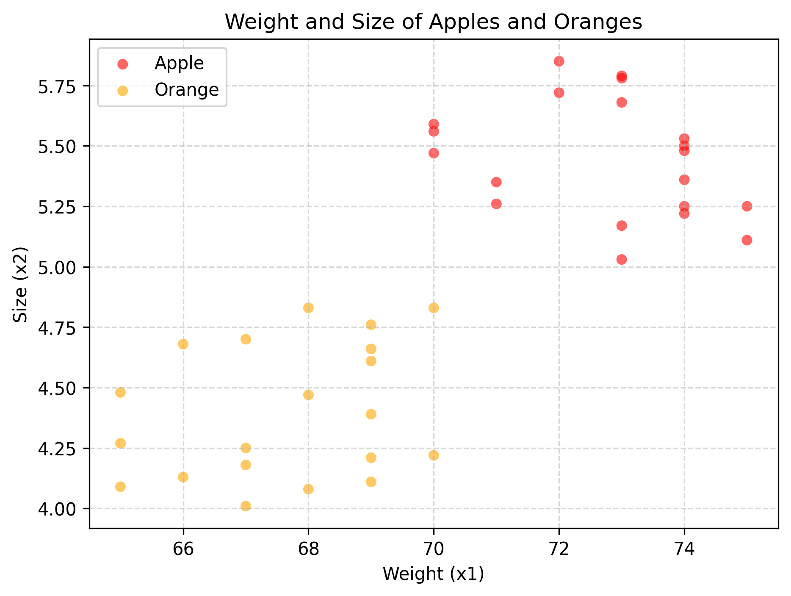
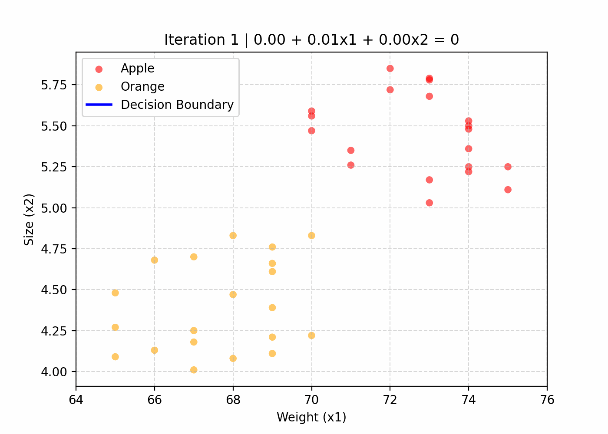
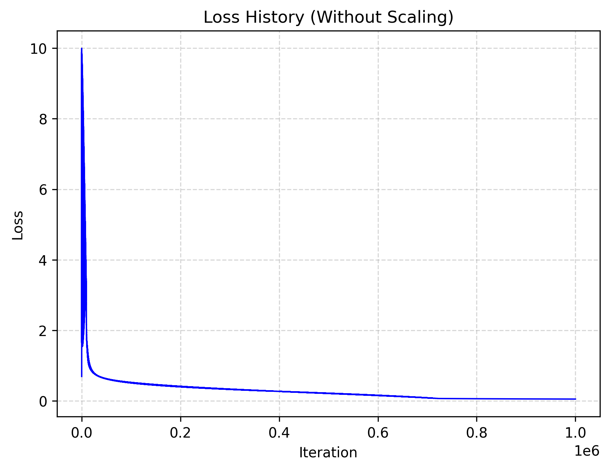
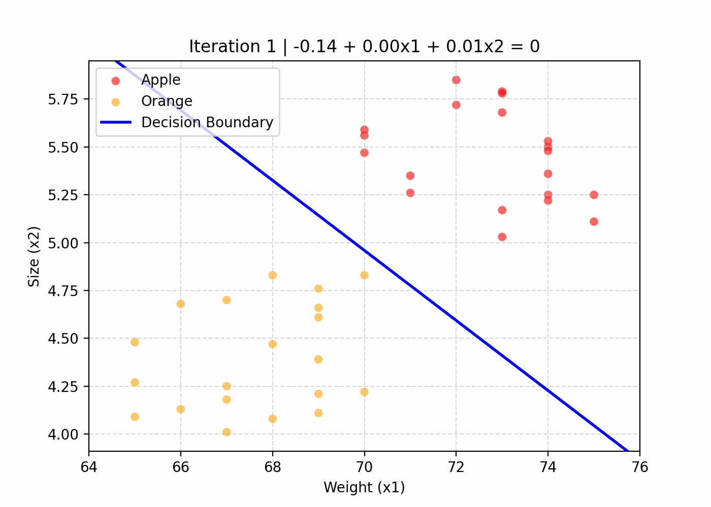
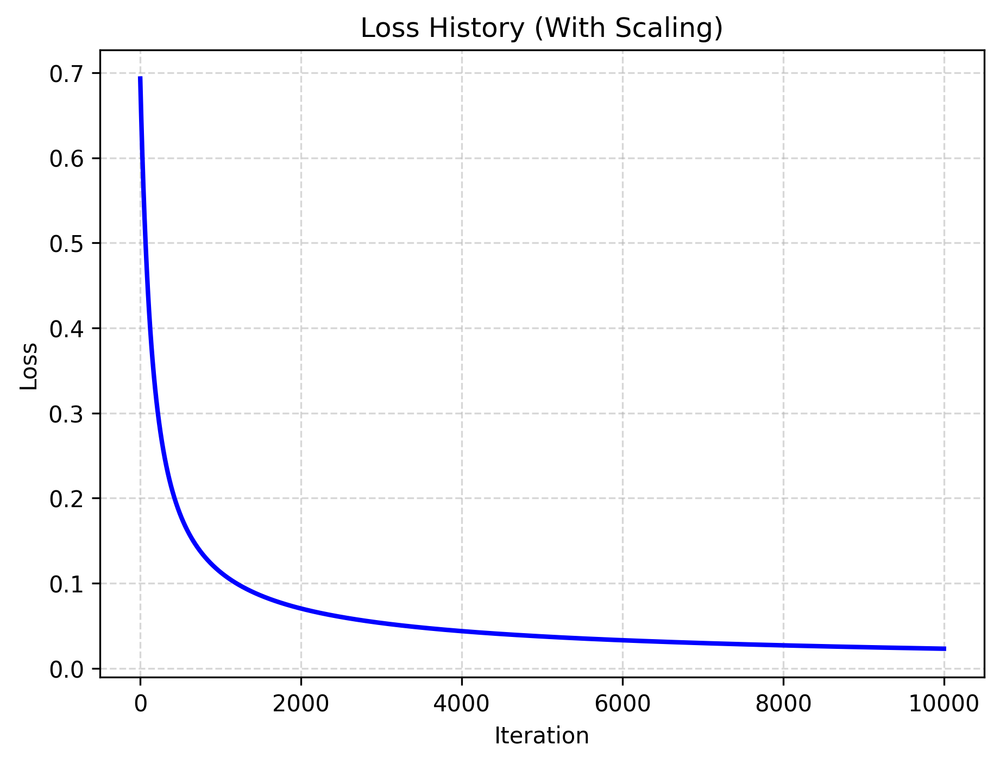
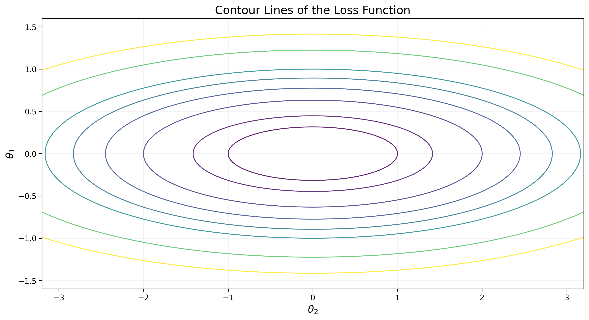
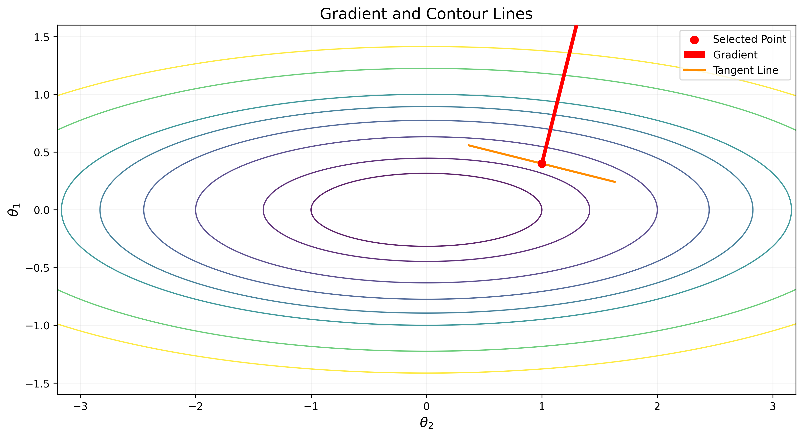
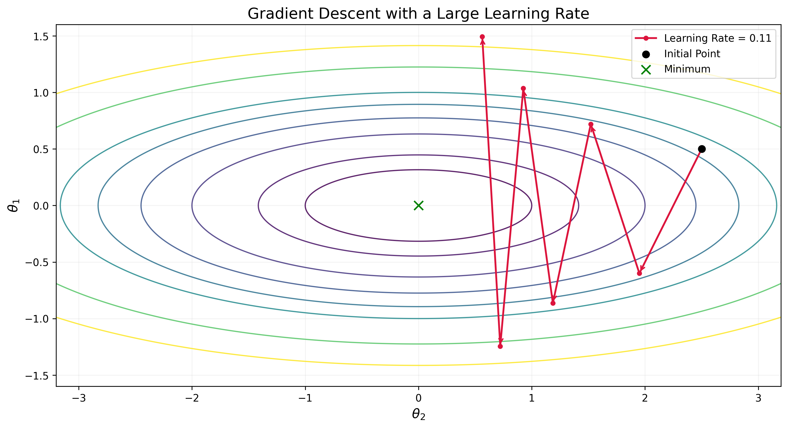
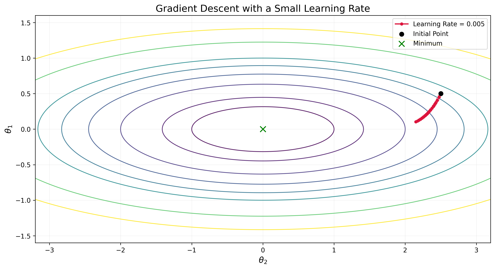

## Apples and Oranges Classification with Logistic Regression

Logistic regression의 학습 과정을 직접 구현하며 복습한 내용을 정리한 포스트이다.
apples_and_oranges dataset을 이용해 logistic regression model을 구현하고, Gradient Descent를 통해 최적의 parameter를 구한다.
또한 feature scaling을 적용했을 때와 안 했을 때의 학습 결과를 비교한다.

## 1. Apples and Oranges Dataset

이 실습에 쓰인 dataset은 Kaggle에서 다운받은 'apples_and_oranges.csv' 파일이다.
이 파일은 'Weight', 'Size', 그리고 'Class'의 세 column을 갖고 있다.
Weight와 Size column은 수치형 데이터로 이뤄져있고, Class column은 "apple" 혹은 "orange" 두 값만 가진다.
또한 총 과일의 개수는 40개다.
즉 과일의 무게와 크기가 주어졌을 때 그 과일이 사과인지 오렌지인지 종류를 예측하는 **binary classification** 문제다.

아래는 이 dataset의 각 data sample을 2D plane에 plot한 이미지이다.

이 dataset을 활용하여 logistic regression model을 training하기 위한 사전 작업을 해야 한다.

Logistic regression model은 linear regression model과 마찬가지로 feature의 linear combination에 bias term을 더한 값을 활용한다. 따라서 feature matrix의 왼쪽에 모든 element가 1인 column을 추가하여 design matrix를 구성한다.

즉, 주어진 dataset의 feature matrix를 아래와 같은 $40 \times 2$ matrix라고 생각하면,

$$
X_\text{feature} =
\begin{bmatrix}
x_1^{(1)}  & x_2^{(1)}  \\
x_1^{(2)}  & x_2^{(2)}  \\
\vdots     & \vdots     \\
x_1^{(40)} & x_2^{(40)} \\
\end{bmatrix}
\in \mathbb{R}^{40 \times 2}
$$

design matrix를 다음과 같이 만드는 것이다.

$$
X =
\begin{bmatrix}
1    & x_1^{(1)}  & x_2^{(1)}  \\
1    & x_1^{(2)}  & x_2^{(2)}  \\
\vdots & \vdots     & \vdots     \\
1    & x_1^{(40)} & x_2^{(40)} \\
\end{bmatrix}
\in \mathbb{R}^{40 \times 3}
$$

또한 원본 dataset의 각 example $i$의 label, $y^{(i)}_{\text{original}}$은 텍스트 데이터이므로 숫자 $1$ 혹은 $0$의 값을 갖도록 바꿔야 한다.
사과이면 1, 사과가 아니면 0으로 표현하게끔 새로운 label column을 만들자.

$$
\mathbf{y} =
\begin{bmatrix} y^{(1)} & y^{(2)} & \cdots & y^{(40)} \end{bmatrix}^T
\quad \text{where} \quad
y^{(i)} =
\begin{cases}
1, & \text{if} \quad y^{(i)}_{\text{original}}=\text{apple},\\
0, & \text{otherwise.}
\end{cases}
$$

## 2. Notations

본격적으로 문제를 해결하기 전, 표기를 확립하자.

| Notation                                                                                                          | Meanings                                                                                      |
| ----------------------------------------------------------------------------------------------------------------- | --------------------------------------------------------------------------------------------- |
| $m$                                                                                                               | example의 개수 (이 문제의 경우 $m=40$)                                                        |
| $n$                                                                                                               | feature의 개수 (이 문제의 경우 $n=2$)                                                         |
| $\mathbf{x}^{(i)}=\begin{bmatrix}1 & x_1^{(i)} & \cdots & x_n^{(i)}\end{bmatrix} \in \mathbb{R}^{1 \times (n+1)}$ | input row vector of example $i$ with bias term $x_0^{(i)}=1$, design matrix의 row $i$와 같음. |
| $y^{(i)} \in \set{0, 1}$                                                                                          | label of example $i$                                                                          |
| $\hat{y}^{(i)} \in (0, 1)$                                                                                        | example $i$에 대한 model의 prediction                                                         |
| $X \in \mathbb{R}^{m \times (n+1)}$                                                                               | design matrix $(X_{i,:}=\mathbf{x}^{(i)})$                                                    |
| $\mathbf{y}=\begin{bmatrix}y^{(1)} & \cdots & y^{(m)}\end{bmatrix}^T \in \set{0, 1}^{m}$                          | target vector                                                                                 |
| $\mathbf{\hat{y}}=\begin{bmatrix}\hat{y}^{(1)} & \cdots & \hat{y}^{(m)}\end{bmatrix}^T \in (0, 1)^{m}$            | prediction vector                                                                             |
| $\mathbf{\theta}=\begin{bmatrix}\theta_0 & \theta_1 & \cdots & \theta_n \end{bmatrix}^T \in \mathbb{R}^{n+1}$     | parameter                                                                                     |
| $h_\theta(x)$                                                                                                     | hypothesis function $(\hat{y}^{(i)}=h_\theta(x^{(i)}))$                                       |
| $J(\theta)$                                                                                                       | loss function                                                                                 |

## 3. Batch Gradient Descent

Logistic regression에 쓰이는 sigmoid fuction (혹은 logistic function)은 다음과 같이 정의된다.

$$
\sigma(z) = \frac{1}{1+e^{-z}}
$$

Sigmoid function은 실수 전체의 집합 $\mathbb{R}$을 열린 구간 $(0, 1)$로 mapping하는데, regression model로 하여금 $0$과 $1$ 사이의 확률 값을 예측하게 할 수 있다.

Hypothesis function을 parameter에 대해 다음과 같이 설정하자.

$$
h_{\theta}(\mathbf{x}^{(i)}) =
\sigma(\theta_0x_0^{(i)}+\theta_1x_1^{(i)}+\theta_2x_2^{(i)}) =
\sigma(\mathbf{x}^{(i)}\theta)
$$

Loss function을 다음과 같이 Binary Cross Entropy로 설정하자.

$$
J(\theta) = -\frac{1}{m} \sum_{i=1}^{m}
(
    y^{(i)}\log\hat{y}^{(i)}+(1-y^{(i)})\log(1-\hat{y}^{(i)})
)
$$

이때 $\hat{y}^{(i)}$는 다음과 같이 나타낼 수 있다.

$$
h_{\theta}(x^{(i)})=\sigma(X_{i,:}\mathbf{\theta})
$$

우리는 아래와 같은 optimization problem을 풀기 위해 gradient descent algorithm을 사용한다.

$$
\theta^{\ast}=\underset{\theta}{\arg\min} J(\theta)
$$

Gradient descent algorithm은 다음과 같이 진행된다.

1. Initialize parameter: $\theta = \theta_{init}$
2. Update parameter until convergence: $\theta \leftarrow \theta - \alpha \nabla_{\theta} J(\theta)$

1번에서 우리는 $\theta_{init}$을 zero vector, $\begin{bmatrix}0 & 0 & 0\end{bmatrix}^T$로 설정한다.

아래에서는 2번 과정을 자세히 서술한다.

먼저 learning rate $\alpha$는 관습에 따라 0.01로 놓는다. (항상 0.01로 설정하라는 뜻은 아니다. 이 문제의 경우 learning rate와 관련된 또 다른 문제가 발생하는데, 이는 추후 다루겠다.)

아래는 loss function의 parameter $\theta$의 $j$번째 성분$(j=0,1,2)$에 대한 gradient를 구하는 과정이다.

$$
\begin{align}

\frac{\partial J}{\partial\theta_j} &=

\frac{\partial}{\partial\theta_j}
(-\frac{1}{m} \sum_{i=1}^{m}
    (
        y^{(i)}\log\hat{y}^{(i)}+(1-y^{(i)})\log(1-\hat{y}^{(i)})
    )
) \\ &=

-\frac{1}{m} \sum_{i=1}^{m}
(
    \frac{y^{(i)}}{\hat{y}^{(i)}}
    \frac{\partial \hat{y}^{(i)}}{\partial \theta_j} + 
    \frac{1-y^{(i)}}{1-\hat{y^{(i)}}}
    \frac{\partial (1-\hat{y}^{(i)})}{\partial \theta_j}
) \\ &=

-\frac{1}{m} \sum_{i=1}^{m}
(
    \frac{y^{(i)}}{\hat{y}^{(i)}}\hat{y}^{(i)}(1-\hat{y}^{(i)}) +
    \frac{1-y^{(i)}}{1-\hat{y}^{(i)}}(-\hat{y}^{(i)})(1-\hat{y}^{(i)})
)x_j^{(i)} \\ &=

-\frac{1}{m} \sum_{i=1}^{m}
(
    y^{(i)} - y^{(i)}\hat{y}^{(i)} - \hat{y}^{(i)} + y^{(i)}\hat{y}^{(i)}
)x_j^{(i)} \\ &=

\frac{1}{m} \sum_{i=1}^m
(
    \hat{y}^{(i)} - y^{(i)}
)x_j^{(i)}

\end{align}
$$

(2)번 수식에서 (3)번 수식으로 넘어갈 때 필요한 partial derivative $\frac{\partial \hat{y}^{(i)}}{\partial \theta_j}$는 다음과 같이 구한다.

$$
\begin{align}
\frac{\partial \hat{y}^{(i)}}{\partial \theta_j}
&=

\frac{\partial}{\partial \theta_j}
(\frac{1}{1+e^{-(\theta_0x_0^{(i)}+\theta_1x_1^{(i)}+\theta_2x_2^{(i)})}})
\\ &=

\frac{x_j^{(i)}e^{-(\theta_0x_0^{(i)}+\theta_1x_1^{(i)}+\theta_2x_2^{(i)})}}
{(1+e^{-(\theta_0x_0^{(i)}+\theta_1x_1^{(i)}+\theta_2x_2^{(i)})})^2} \\ &=

\hat{y}^{(i)}(1-\hat{y}^{(i)}) x_j^{(i)}

\end{align}
$$

아래와 같이 유도하면 parameter vector에 대한 loss function의 gradient를 구할 수 있다.

$$
\begin{align}

\nabla_{\theta}J(\theta) &=

\begin{bmatrix}
\frac{\partial J}{\partial\theta_0} &
\frac{\partial J}{\partial\theta_1} &
\frac{\partial J}{\partial\theta_2}
\end{bmatrix}^T \\ &=

\begin{bmatrix}
\frac{1}{m} \sum_{i=1}^m(\hat{y}^{(i)} - y^{(i)})x_0^{(i)} \\
\frac{1}{m} \sum_{i=1}^m(\hat{y}^{(i)} - y^{(i)})x_1^{(i)} \\
\frac{1}{m} \sum_{i=1}^m(\hat{y}^{(i)} - y^{(i)})x_2^{(i)}
\end{bmatrix} \\ &=

\frac{1}{m} X^T(\hat{\mathbf{y}} - \mathbf{y})

\end{align}
$$

2번 과정을 learning rate $\alpha=0.01$에 대해 1000000번 수행하면 다음과 같이 업데이트된 parameter를 얻는다.

$$
\theta_0=-45.95134005,\quad\theta_1=-0.22100812, \quad \theta_2=12.46160506
$$

즉, 업데이트된 parameter를 반영한 hypothesis function은 아래와 같다.

$$
h_{\theta}(\mathbf{x}) =
\sigma(\mathbf{x}\theta) = \sigma(-45.95134005 + -0.22100812x_1 + 12.46160506x_2)
$$

위 hypothesis function은 무게가 $x_1$이고 크기가 $x_2$인 과일이 사과일 '확률'을 예측한다.
하지만 어떤 과일의 종류를 예측해야 한다면, 어떻게 할 것인가?
일반적으로 사과일 확률이 $0.5$보다 크거나 같으면 사과라고, 그렇지 않으면 오렌지라고 예측하는 방법을 택할 것이다.
수식으로 표현하면 아래와 같다.

$$
\hat{y}_{\text{class}} = 
\begin{cases}
\text{apple}  & \text{, if} \quad h_{\theta}(\mathbf{x}) \ge 0.5, \\
\text{orange} & \text{, otherwise.}
\end{cases}
$$

이때 사과인지 오렌지인지 결정하는 경계는 $h_\theta(\mathbf{x})=0.5$ ($\mathbf{x\theta}=0$과 동치)이다.
이처럼 classification 문제에서 class를 나누는 경계를 결정 경계(decision boundary)라고 한다.

이 문제의 경우, decision boundary의 방정식은 아래와 같다.

$$
\theta_0+\theta_1x_1+\theta_2x_2=0
$$

아래는 2번 과정에서 parameter가 업데이트됨에 따라 decision boundary가 어떻게 fitting되는지 보여주는 애니메이션이다.

또한 아래는 training에 따른 loss의 변화를 보이는 loss curve이다.

## 4. Feature Scaling

Linear regression practice에서 좋은 parameter를 찾기 위해 1만번의 update 정도면 충분했던 것과 달리 이 문제에서는 1백만번의 update가 필요했다. 위 애니메이션과 이미지를 보면, decision boundary가 training 과정에서 '부드럽게' 이동하는 게 아닌, 불안정하게 '뚝뚝' 끊기며 순간이동한다. 뿐만 아니라, loss curve가 training 초기에는 급격히 상승하는 모습도 보였다.

Update 횟수를 무작정 늘리는 것이 아닌 새로운 해결책이 필요하다.
바로 **Feature Scaling**이다.

Feature scaling은 각 feature의 값의 범위를 조정하여 feature 간 수치적 규모 차이를 줄이는 data preprocessing 과정이다.
각 feature의 값의 범위를 조정하는 몇 가지 방법이 있지만 필자는 **standardization** 방법을 활용했다.

조정된 후의 example $i$를 $\tilde{\mathbf{x}}^{(i)}=\begin{bmatrix} \tilde{x}_0^{(i)} & \tilde{x}_1^{(i)} & \tilde{x}_2^{(i)} \end{bmatrix}$라 하자.

Standardization 방법에 따르면 $\mathbf{x}^{(i)}$를 $\tilde{\mathbf{x}}^{(i)}$로 변환하는 과정은 다음과 같다.

$$
\begin{align}
    \mu_j &= \frac{1}{m} \sum_{i=1}^m x_j^{(i)}, \\
    \sigma_j &= \sqrt{\frac{1}{m} \sum_{i=1}^m (x_j^{(i)}-\mu_j)^2} \\
    \tilde{x}_j^{(i)} &= \frac{x_j^{(i)} - \mu_j}{\sigma_j}
\end{align}
$$

이때 $j=0$인 경우는 제외한다. Bias를 다루기 위해 추가한 dummy feature인 $1$마저 standardization으로 조정한다면, 모두 $0$이 된다.

1번 섹션에서 얻은 design matrix를 조정된 feature로 대신하는 것을 제외하면 training의 경우는 위의 내용처럼 진행하면 된다. 학습된 model을 활용하여 새로운 query point에 대한 prediction을 만들어야 할 때면, 그 query point도 같은 규칙으로 feature scaling하여 적용하면 된다.

Feature scaling을 적용했을 때는 1만번의 parameter update만으로 적용하지 않았을 때보다 더 좋은 결과를 보였다.
이 경우 얻은 parameter는 아래와 같다.

$$
\theta_0=-0.39211124, \quad \theta_1=2.80167033, \quad \theta_2=3.47616205
$$

Feature scaling을 적용하여 parameter를 update함에 따라 decision boundary가 fitting되는 과정을 아래의 애니메이션으로 보인다.

이때 그래프 상 찍혀있는 점들은 각각 원본 dataset의 example이다. 따라서 standardization에 의해 조정된 feature에 대해 fitting된 parameter들을 원본 feature에 맞게 역조정해야 한다. 조정된 feature에 대한 parameter를 $\tilde{\theta} = \begin{bmatrix}\tilde{\theta}_0 & \tilde{\theta}_1 & \tilde{\theta}_2\end{bmatrix}^T$라 하면, 원본 feature에 대한 decision boundary를 구하는 과정은 다음과 같다.

$$
\begin{align}
    P(y=1 \mid \mathbf{x}) &=
    \sigma(\tilde{\theta}_0 + \tilde{\theta}_1\tilde{x}_1 + \tilde{\theta}_2\tilde{x}_2) \\ &=
    \sigma(\tilde{\theta}_0 + \tilde{\theta}_1\frac{x_1-\mu_1}{\sigma_1} + \tilde{\theta}_2\frac{x_2-\mu_2}{\sigma_2}) \\ &=
    \sigma((\tilde{\theta}_0-\frac{\tilde{\theta}_1\mu_1}{\sigma_1}-\frac{\tilde{\theta}_2\mu_2}{\sigma_2}) + \frac{\tilde{\theta}_1}{\sigma_1}x_1 + \frac{\tilde{\theta}_2}{\sigma_2}x_2)
\end{align} \\
$$

이때 decision boundary는 $(\tilde{\theta}_0-\frac{\tilde{\theta}_1\mu_1}{\sigma_1}-\frac{\tilde{\theta}_2\mu_2}{\sigma_2}) + \frac{\tilde{\theta}_1}{\sigma_1}x_1 + \frac{\tilde{\theta}_2}{\sigma_2}x_2=0$을 만족하는 점 $(x_1, x_2)$의 집합이다.

또한 아래는 feature scaling을 적용했을 때의 loss curve이다.

## 5. Why Feature Scaling Matters?

Feature scaling을 적용한 경우 10,000번의 parameter update를 통해 loss를 약 0.02까지 감소시킬 수 있었다.
반면 feature scaling을 적용하지 않은 경우 1,000,000번의 parameter update를 수행했음에도 loss는 약 0.05에 머물렀다.

동일한 learning rate를 사용한 이번 실험에서는 feature scaling을 적용한 경우가 100배 적은 parameter update만으로 더 낮은 loss에 도달했다.

그렇다면 feature scaling은 왜 이러한 차이를 만들어냈을까?

먼저 'apples_and_oranges.csv' dataset에서 두 feature인 'Weight' $(x_1^{(i)})$와 'Size' $(x_2^{(i)})$의 range를 살펴보자.

$$
65.0 \le x_1^{(i)} \le 75.0, \quad 4.01 \le x_2^{(i)} \le 5.85 \quad \text{for} \quad i=1,\ldots,m
$$

Dataset의 첫 번째 sample은 다음과 같다.

$$
x_1^{(1)}=69, \quad x_2^{(1)}=4.39, \quad y_{\text{original}}^{(1)}=\text{orange}
$$

이 sample에 대한 loss를 $J^{(i)}$이라고 하자. 각 parameter에 대한 partial derivative는 다음과 같다.

$$
\frac{\partial}{\partial \theta_1}J^{(1)}(\theta) =
(\hat{y}^{(1)}-y^{(1)})x_1^{(1)}, \quad
\frac{\partial}{\partial \theta_2}J^{(1)}(\theta) =
(\hat{y}^{(1)}-y^{(1)})x_2^{(1)}
$$

첫 번째 sample의 feature 값을 대입하면,

$$
\frac{\partial}{\partial \theta_1}J^{(1)}(\theta) =
69(\hat{y}^{(1)}-y^{(1)}), \quad
\frac{\partial}{\partial \theta_2}J^{(1)}(\theta) =
4.39(\hat{y}^{(1)}-y^{(1)})
$$

따라서 이 sample이 각 parameter의 gradient에 기여하는 크기를 비교하면, $\theta_1$ 방향의 기여도가 $\theta_2$ 방향보다 약 15.72배 크다.

이는 feature의 수치적 규모가 각 parameter의 gradient에 영향을 미친다는 것을 보여준다.

물론 실제 batch gradient descent에서는 모든 sample의 gradient contribution을 평균하므로, 전체 gradient의 크기 비율이 반드시 15.72배가 되는 것은 아니다.

그럼에도 feature 간 scale 차이가 parameter update의 크기에 영향을 줄 수 있다는 점은 확인할 수 있다.

Gradient descent의 parameter update는 다음과 같다.

$$
\theta_1 \leftarrow
\theta_1 - \alpha \frac{\partial}{\partial \theta_1} J(\theta), \quad
\theta_2 \leftarrow
\theta_2 - \alpha \frac{\partial}{\partial \theta_2} J(\theta)
$$

동일한 learning rate를 사용하므로, gradient의 크기가 큰 parameter 방향에서는 상대적으로 큰 update가 발생할 수 있다.

이러한 update 크기의 불균형이 심해지면 gradient descent는 minimum을 향해 효율적으로 이동하기 어려워진다.

이를 이해하기 위해 parameter에서 동일한 loss value를 갖는 지점들을 연결한 contour line을 살펴보자.

<figure>
  
  <figcaption>
    Figure 5.1. Contour lines of the loss function in the parameter space.
  </figcaption>
</figure>

두 parameter 방향에서 loss가 변하는 정도에 차이가 크다면, 한 방향으로는 parameter를 조금만 움직여도 loss가 크게 변하지만 다른 방향으로는 parameter를 훨씬 많이 움직여야 비슷한 정도로 loss가 변할 수 있다.

이러한 상황에서는 contour line이 한 방향으로 길고 좁은 ellipse 형태를 띨 수 있다.

이때 gradient는 contour line에 수직인 방향을 가리킨다.

<figure>
  
  <figcaption>
    Figure 5.2. The gradient vector is perpendicular to the tangent
    of the contour line at a given point.
  </figcaption>
</figure>

따라서 Gradient Descent는 길고 좁은 contour에서 minimum을 향해 이동하는 과정에서 한 방향으로 크게 움직이다가 반대편으로 넘어가는 현상을 반복할 수 있다.

<figure>
  
  <figcaption>
    Figure 5.3. Gradient Descent with a large learning rate,
    resulting in divergence.
  </figcaption>
</figure>

특히 짧은 축 방향으로는 지나치게 크게 움직이며 진동할 수 있고, 긴 축 방향으로는 상대적으로 천천히 이동하게 된다.

결과적으로 minimum에 도달하기까지 더 많은 parameter update가 필요해질 수 있다.

<figure>
  
  <figcaption>
    Figure 5.4. Gradient Descent with a small learning rate,
    resulting in slow convergence.
  </figcaption>
</figure>

Feature scaling은 각 feature의 수치적 규모 차이를 줄여 이러한 불균형을 완화하는 데 도움을 준다. 따라서 Gradient Descent가 더욱 효율적으로 parameter를 학습할 수 있도록 한다.